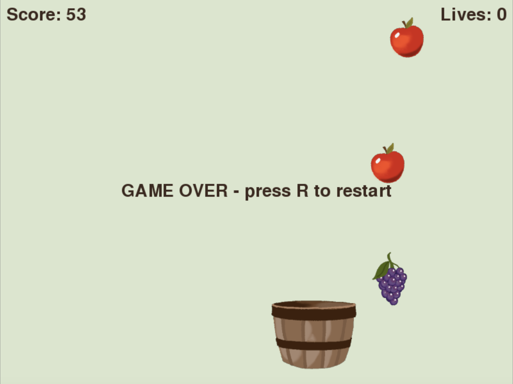

# Catch Game

A 2D arcade game built with Python and pygame, playable in the browser. Catch falling fruit with a basket and avoid the bombs.

**Live demo:** [Click To Play](https://catchgame-gules.vercel.app/)



## Gameplay

Move the basket to catch falling fruit. Each catch scores one point. The player starts with three lives and loses one when:

- a fruit is missed, or
- a bomb is caught.

Bombs that are not caught have no penalty.

## Controls

| Key | Action |
| --- | --- |
| Left / Right arrow | Move the basket |
| P | Pause or resume |
| R | Restart after game over |

## Artwork

All visual assets (the basket, four fruits, and the bomb) are hand-drawn original artwork.

## Running locally

Requires Python 3.10 or newer.

```
pip install pygame-ce
python main.py
```

## Building for the web

The browser version is packaged with [pygbag](https://pygame-web.github.io/wiki/pygbag/), which runs Python and pygame in the browser using WebAssembly.

```
pip install pygbag
pygbag main.py          # build and serve at http://localhost:8000
pygbag --build main.py  # build only
```

The output is written to `build/web` and can be deployed to any static hosting service.

## Project structure

```
main.py         Game logic and main loop
*.png           Hand-drawn game assets
build/web/      Generated web build
```

## Technical notes

- The game loop follows an input, update, draw cycle at 60 FPS.
- Falling objects are instances of an `Item` class that holds an image, a hitbox, and a type (fruit or bomb).
- Collisions use rectangle overlap tests.
- The main loop is asynchronous, as required for browser execution.
